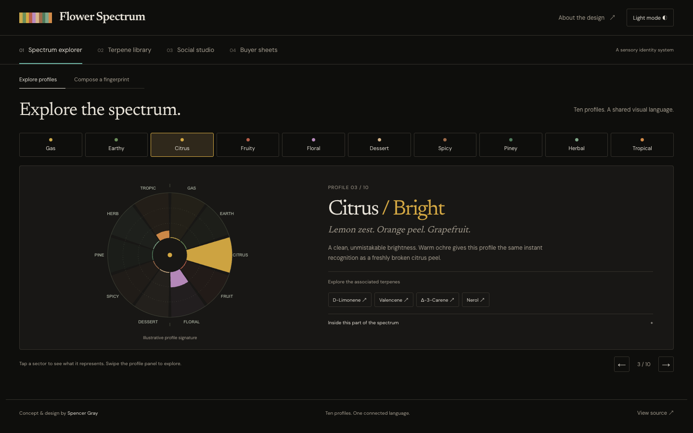

# The Flower Spectrum

A language for what you smell. An interactive portfolio website showcasing Spencer Gray’s aroma identity concept and design system.

**[Explore the live site](https://the-flower-spectrum.vercel.app)** · **[GitHub](https://github.com/cannacre8ive/the-flower-spectrum)**



## The experience

Four connected tabs replace the long scrolling showcase: Spectrum explorer, Terpene library, Social studio, and Buyer sheets. One panel is visible at a time, with restrained transitions, keyboard navigation, shareable URLs, and browser history. Each tool preserves its state when switching tabs. Social and buyer selections synchronize in both directions. The explorer includes profile browsing and fingerprint composition as two modes.

The original warm ink palette, Newsreader wordmark, and ten-color strip lead the interface. Design anatomy and photographic originals live in the **About the design** dialog.

- **Interactive spectrum:** ten clickable and keyboard-accessible sectors, fixed colors and positions, expandable explanations, associated terpene cards, and swipe navigation.
- **Education library:** all 38 source terpene cards, with search, profile filters, primary/key-impact/supporting collections, expandable details, drag/swipe browsing, and the original education PDFs.
- **Cultivator social studio:** six layouts from the supplied Social Kit, three strain presets, farm/handle personalization, native-size PNG and self-contained SVG export, and full-size inspection.
- **Wholesale chemovar sheets:** all three historical sample one-pagers, including lineage, lot/sample IDs, chemistry, aroma architecture, the complete reported analyte panel, single-page sample PDFs, and editable printable HTML downloads. The PDF examples retain the original farm name; editable sheets reflect personalization.
- **Dark-first interface:** persistent light-mode option, restrained entrance and interaction motion, animated disclosures, and reduced-motion support.
- **Fingerprint lab:** three historical sample presets, six adjustable terpene values, synchronized radial fingerprints, identity cards, and spectrum strips.
- **Editable exports:** downloadable standalone SVGs for each preview format, carrying the sample/illustrative distinction.
- **System anatomy:** a closer look at fingerprints, strips, palette, typography, and supplied profile-card artwork.
- **Specimen archive:** eight original cards with aroma filters, accessible detail dialogs, and original-image downloads. The supplied JPEGs are 398 × 594 pixels and are displayed at up to 199 CSS pixels wide for 2x pixel density; they are not upscaled. Fingerprints and generated cards use live vectors and text.

## Run locally

Requires Node.js 22 or later. No third-party runtime dependencies, accounts, API keys, or installation step are required.

```sh
npm run dev      # http://localhost:4173
npm run check    # classification/export tests, then production build
npm run build   # static output in dist/
```

Vercel builds with `npm run build` and serves `dist/`. GitHub and Vercel use the slug `the-flower-spectrum`; the visible project title is **The Flower Spectrum**.

## Editing

| File | Purpose |
|---|---|
| `index.html` | Workspace shell, four panels, dialogs, metadata |
| `src/style.css` | Base component styles |
| `src/workspace.css` | Focused tab layout, source palette, compact responsive styles |
| `src/workspace.js` | Accessible tabs, routing, history, transitions, design dialog |
| `src/content.js` | Profile copy and original card captions |
| `src/engine.js` | Classification rules and historical sample panels extracted from the supplied Social Kit prototype |
| `src/visuals.js` | Fixed-sector fingerprint, strip, illustrative signatures, standalone SVG export |
| `src/app.js` | Profile selection, lab state, formats, gallery, dialogs |
| `src/experience.js` | Theme, searchable education library, gestures, social studio, buyer sheets |
| `src/social-designs.js` | Six SVG compositions and native PNG/SVG exports with embedded fonts |
| `src/buyer-sheet.js` | Responsive chemovar sheet and self-contained print export |
| `src/education-data.js` | All 38 source educational terpene entries |
| `src/expanded.css` | Dark/light themes and expanded experience |
| `public/assets/` | Supplied artwork and self-hosted open-source fonts |
| `docs/provenance.json` | SHA-256 hashes and asset lineage |

The site is deliberately dependency-light: native browser modules, semantic HTML, CSS, SVG, and native dialog controls. Fonts are served locally; the deployed site makes no third-party data requests.

## Evidence and scope

This is a **portfolio demonstration**, not a retail storefront or a validated scientific classifier. The supplied Social Kit prototype includes July 2023 historical panels for Jelly Breath, Sunday Driver, and Kush Mints. Original laboratory PDFs were not supplied, and these data have not been independently validated.

The lab retains the prototype’s classification weights and gas-balance heuristic. Fingerprint lengths are relative to the strongest profile. Model score percentages are rounded independently and may not total exactly 100%. The strip includes up to three profiles at 60% or more of the leader, then normalizes their widths within the selected group.

The six sliders edit six primary notes; the selected sample’s other modeled terpenes remain present. Clear resets **all** values. Any edit is labeled illustrative. The ten profile-atlas signatures are expressly illustrative, not measured cultivar profiles. A displayed total is the sum of modeled terpene inputs, which may differ from the source panel’s total because unmodeled analytes are excluded.

The expanded Social Kit designs retain the source formats and data while replacing unsupported “validated COA” language with historical-source labels. The comparison is titled “Same system. Different flower.” because the chosen samples have different THC values. Current commercial fields are shown as not supplied.

Original cards are preserved byte-for-byte, including their SIM/REAL labels. Those labels are source content, not independent verification. Original profile artwork may contain legacy educational copy; it is shown as design artwork, not an endorsed effects claim. Aroma profiles do not predict medical outcomes.

The new showcase is isolated from prior Flower Spectrum repositories and deployments. Source prototypes and the supplied PDF are preserved in the local task’s private working archive; public provenance records contain checksums without private filesystem paths.

## Validation

- Nine automated tests cover known sample outputs, empty states, strip rules across deterministic randomized blends, reference signatures, portable exports, 38 unique educational entries, 18 social sample/format combinations, and complete buyer panels.
- The current browser suite checks all four tab panels, keyboard navigation, preserved tool state, cross-tool links, shared strain selections, SVG/PNG/HTML exports, browser history, old and new deep links, original artwork, dialog focus, both themes, and reduced motion. Results: `docs/qa-v3.json`. Earlier suites remain as historical validation of the source components.
- Layouts checked at 320, 390, 768, and 1440 pixels with no horizontal overflow.
- Screenshots and the latest browser check result are in `docs/`. To rerun browser checks, install Playwright as a local test tool, start the dev server, then run `node scripts/browser-qa-v3.cjs`. Set `SITE_URL` for production checks and `CHROME_PATH` to use a local Chrome executable.

## Credits and rights

Concept and design: Spencer Gray. Original images and artwork supplied by the project owner; original asset files are unchanged. Newsreader and DM Sans are distributed under their included SIL Open Font Licenses. No blanket license is granted for the project artwork.
