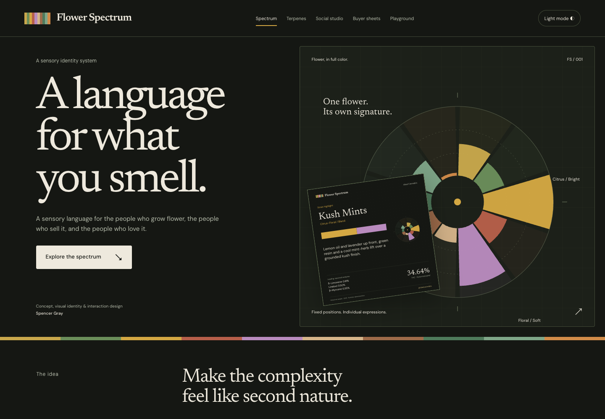

# The Flower Spectrum

A language for what you smell. An interactive portfolio website showcasing Spencer Gray’s aroma identity concept and design system.

**[Explore the live site](https://the-flower-spectrum.vercel.app)** · **[GitHub](https://github.com/cannacre8ive/the-flower-spectrum)**



## The experience

- **Profile atlas:** ten aroma identities, fixed colors and positions, sensory descriptions, and illustrative signatures.
- **Fingerprint lab:** three historical sample presets, six adjustable terpene values, synchronized radial fingerprints, identity cards, and spectrum strips.
- **Editable exports:** downloadable standalone SVGs for each preview format, carrying the sample/illustrative distinction.
- **System anatomy:** a closer look at fingerprints, strips, palette, typography, and supplied profile-card artwork.
- **Specimen gallery:** eight original cards with aroma filters, accessible detail dialogs, and original-image downloads.

## Run locally

Requires Node.js 22 or later. No third-party runtime dependencies, accounts, API keys, or installation step are required.

```sh
npm run dev      # http://localhost:4173
npm run check    # classification/export tests, then production build
npm run build   # static output in dist/
```

Vercel builds with `npm run build` and serves `dist/`. GitHub and Vercel use the slug `the-flower-spectrum`; the visible project title is **The Flower Spectrum**.

## Editing

| File | Purpose |
|---|---|
| `index.html` | Page narrative, sections, metadata |
| `src/style.css` | Visual tokens, layout, responsive states |
| `src/content.js` | Profile copy and original card captions |
| `src/engine.js` | Classification rules and historical sample panels extracted from the supplied Social Kit prototype |
| `src/visuals.js` | Fixed-sector fingerprint, strip, illustrative signatures, standalone SVG export |
| `src/app.js` | Profile selection, lab state, formats, gallery, dialogs |
| `public/assets/` | Supplied artwork and self-hosted open-source fonts |
| `docs/provenance.json` | SHA-256 hashes and asset lineage |

The site is deliberately dependency-light: native browser modules, semantic HTML, CSS, SVG, and native dialog controls. Fonts are served locally; the deployed site makes no third-party data requests.

## Evidence and scope

This is a **portfolio demonstration**, not a retail storefront or a validated scientific classifier. The supplied Social Kit prototype includes July 2023 historical panels for Jelly Breath, Sunday Driver, and Kush Mints. Original laboratory PDFs were not supplied, and these data have not been independently validated.

The lab retains the prototype’s classification weights and gas-balance heuristic. Fingerprint lengths are relative to the strongest profile. Model score percentages are rounded independently and may not total exactly 100%. The strip includes up to three profiles at 60% or more of the leader, then normalizes their widths within the selected group.

The six sliders edit six primary notes; the selected sample’s other modeled terpenes remain present. Clear resets **all** values. Any edit is labeled illustrative. The ten profile-atlas signatures are expressly illustrative, not measured cultivar profiles. A displayed total is the sum of modeled terpene inputs, which may differ from the source panel’s total because unmodeled analytes are excluded.

Original cards are preserved byte-for-byte, including their SIM/REAL labels. Those labels are source content, not independent verification. Original profile artwork may contain legacy educational copy; it is shown as design artwork, not an endorsed effects claim. Aroma profiles do not predict medical outcomes.

The new showcase is isolated from prior Flower Spectrum repositories and deployments. Source prototypes and the supplied PDF are preserved in the local task’s private working archive; public provenance records contain checksums without private filesystem paths.

## Validation

- Six automated tests cover known sample outputs, empty states, strip rules across deterministic randomized blends, reference signatures, and safe portable exports.
- Browser checks cover all profiles, presets, slider updates, three downloads, clear/reset, all design tabs, keyboard interactions, filters, dialog focus restoration, deep links, reduced motion, and image loading.
- Layouts checked at 320, 390, 768, and 1440 pixels with no horizontal overflow.
- Screenshots and the latest browser check result are in `docs/`. To rerun browser checks, install Playwright as a local test tool, start the dev server, then run `node scripts/browser-qa.cjs`. Set `SITE_URL` for production checks and `CHROME_PATH` to use a local Chrome executable.

## Credits and rights

Concept and design: Spencer Gray. Original images and artwork supplied by the project owner; original asset files are unchanged. Newsreader and DM Sans are distributed under their included SIL Open Font Licenses. No blanket license is granted for the project artwork.
